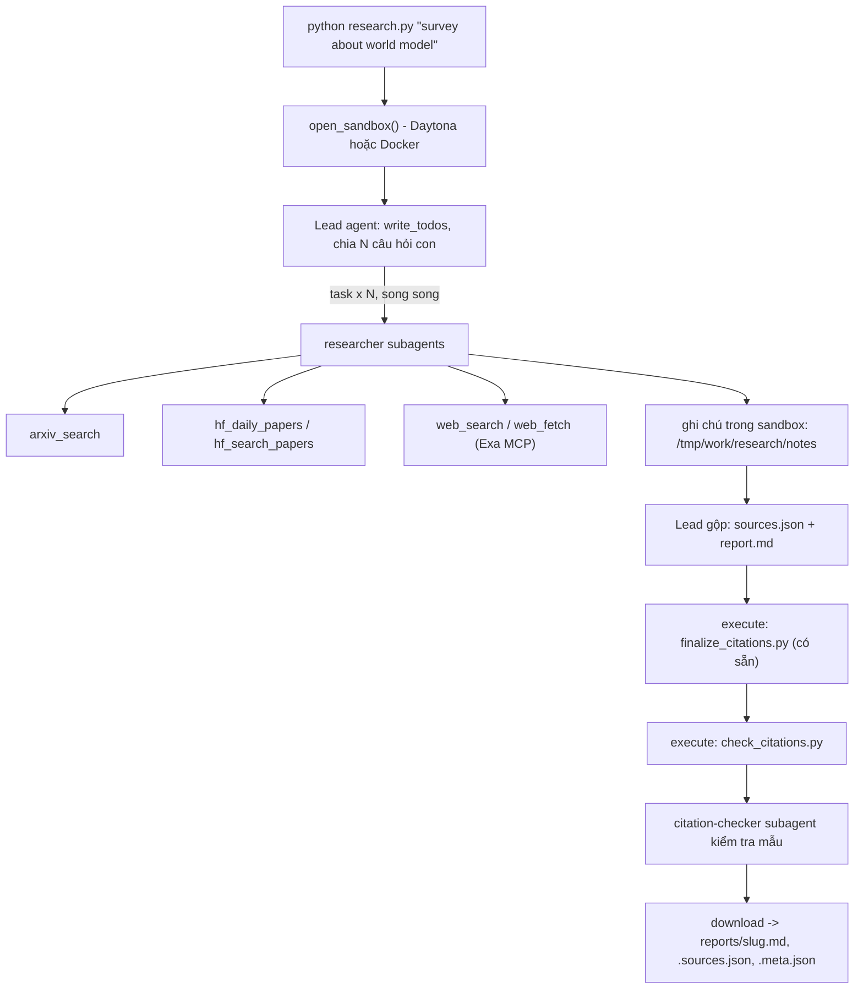

# Deep Research Agent (Deep Agents + Sandbox)

Hệ thống deep research đa tác tử: nhập một chủ đề (ví dụ `survey about world model`), hệ thống lập kế hoạch, giao việc cho các subagent tìm tài liệu trên arXiv, Hugging Face và web, rồi viết một **báo cáo có trích dẫn** `[n]` mà mọi nguồn đều có thật.

Ngôn ngữ: Python 3.11+. Hình thức: bài thực hành cá nhân.

## 1. Hệ thống làm gì



Nguồn dữ liệu:

| Nguồn | Dùng để |
|---|---|
| arXiv API `https://export.arxiv.org/api/query` | Tìm bài theo từ khóa, sắp theo ngày |
| Hugging Face Daily Papers `/api/daily_papers` | Bài đang được quan tâm: upvotes, githubRepo, summary |
| Hugging Face papers search `/api/papers/search?q=` | Tìm bài theo chủ đề |
| Web qua Exa MCP (`web_search_exa`, `web_fetch_exa`) | Blog, survey, trang dự án, nội dung đầy đủ của một URL |

## 2. Cài đặt

Yêu cầu: Python 3.11+, một khóa LLM có hỗ trợ tool calling, một khóa sandbox (Daytona) hoặc Docker đang chạy, và khóa Exa (khuyến nghị).

```powershell
python -m venv .venv
.\.venv\Scripts\Activate.ps1
pip install -r requirements.txt
copy .env.example .env
```

Điền `.env` (không bao giờ commit file này):

| Biến | Ý nghĩa | Ví dụ |
|---|---|---|
| `LAB_MODEL` | Model dùng cho lead và subagent, dạng `provider:tên-model` | `google_genai:gemini-3.5-flash-lite` |
| `GOOGLE_API_KEY` | Khóa của provider tương ứng với `LAB_MODEL` | |
| `EXA_API_KEY` | Khóa Exa cho web search và đọc trang | |
| `DAYTONA_API_KEY` | Khóa Daytona, dùng khi sandbox là Daytona | |
| `DAYTONA_TARGET` | Region Daytona, nếu tổ chức chưa có region mặc định | `us` |
| `SANDBOX` | `docker` để chạy sandbox bằng container Docker cục bộ | `docker` |

Mô hình phải hỗ trợ tool calling. Bài đã được kiểm tra với `google_genai:gemini-3.5-flash-lite`.

## 3. Chạy

```powershell
python research.py "survey about world model"
```

Kết quả nằm trong `reports/`:

| File | Nội dung |
|---|---|
| `<slug>.md` | Báo cáo, có mục `## References` do script sinh ra |
| `<slug>.sources.json` | Danh sách nguồn `{n, id, url, title, date, source}` |
| `<slug>.meta.json` | Bằng chứng chạy: `subagent_calls`, `source_families`, `n_sources`, `tool_calls`, `elapsed_s`, `tokens` (chỉ tính lead) |

Nếu một lần chạy không tạo được báo cáo hợp lệ, `research.py` thoát với mã 1 và **không ghi file nào** vào `reports/`.

Chạy đủ 5 chủ đề trong [`topics.md`](topics.md), mỗi chủ đề một lần.

## 4. Kiểm tra trước khi nộp

```powershell
python self_check.py
python check_citations.py reports\<slug>.md reports\<slug>.sources.json
```

`self_check.py` kiểm tra đủ 5 báo cáo, `meta.json`, trích dẫn bằng `check_citations.py` và không có khóa API trong git.

## 5. Cấu trúc thư mục

```
Lab/
├── README.md  GUIDE.md  RUBRIC.md  REPORT_TEMPLATE.md   tài liệu
├── topics.md                 5 chủ đề cần chạy
├── requirements.txt  .env.example  .gitignore
├── model.py                  CÓ SẴN - không sửa: tạo mô hình LLM từ biến môi trường
├── sandbox.py                CÓ SẴN - không sửa: sandbox Daytona (hoặc Docker), upload, download
├── self_check.py             CÓ SẴN - không sửa: tự kiểm tra trước khi nộp
├── finalize_citations.py     CÓ SẴN - không sửa: script chạy trong sandbox, sinh `## References` và đánh số lại trích dẫn
├── tools.py                  retry + 5 công cụ nguồn dữ liệu
├── agents.py                 prompt, subagent, lead agent
├── research.py               script chính: sandbox, chạy agent, lưu 3 file
├── check_citations.py        kiểm tra trích dẫn, chạy TRONG sandbox và trên máy
└── reports/                  báo cáo sinh ra
```

## 6. Thiết kế đáng chú ý

- **Công cụ không ném lỗi.** Mỗi công cụ trả chuỗi: kết quả, `NO RESULTS` khi nguồn rỗng, hoặc `ERROR: ...` khi nguồn hỏng sau khi đã retry. Lỗi 429 và 5xx được retry với backoff lũy thừa, jitter và `Retry-After`. Khóa Exa được che trong thông báo lỗi.
- **Giới hạn vòng lặp.** Lead và mỗi subagent có `ModelCallLimitMiddleware` và `ToolCallLimitMiddleware`, cộng `recursion_limit=1000`.
- **Xử lý tất định sau LLM.** `finalize_citations.py` đánh số lại trích dẫn và sinh `## References`. `check_citations.py` kiểm tra hai chiều: mọi `[n]` phải có nguồn, và mọi nguồn phải được trích dẫn đúng một dòng tham khảo với đúng một URL.
- **Không đưa bí mật vào sandbox.** Mọi công cụ gọi mạng chạy ở host. Sandbox không có khóa API.
- **Nội dung web là dữ liệu.** Prompt của researcher và citation-checker yêu cầu bỏ qua mọi chỉ dẫn nằm trong trang web.

## 7. Chi phí và giới hạn

- Mỗi lần chạy tốn token LLM và thời gian sandbox. `tokens` trong `meta.json` chỉ đếm tin nhắn của lead, nên chi phí thật cao hơn.
- Gói miễn phí của Google giới hạn số request mỗi phút cho từng model. Khi bị giới hạn, `research.py` thoát với lỗi `RESOURCE_EXHAUSTED`. Hãy chạy lại chủ đề đó sau vài phút.
- Kết quả có tính ngẫu nhiên. Khi báo cáo không đạt, sửa prompt và mã rồi chạy lại. Không sửa tay báo cáo.
- Gói miễn phí giới hạn 500 request mỗi ngày cho từng model. Khi hết hạn mức trong ngày, lần chạy thất bại với `429 RESOURCE_EXHAUSTED` và không ghi file nào.

## 8. Hạn chế đã biết

- **Model:** cả 5 báo cáo được tạo bằng `google_genai:gemini-3.5-flash-lite`. Các báo cáo của chủ đề 2 và 3 được tạo lại sau khi đổi khóa Google.
- **Kiểm tra tự động:** mọi báo cáo đều đạt số lần gọi `task` ≥ 3, số họ nguồn ≥ 3, validator `OK`. Tiêu đề của mọi nguồn khớp với nội dung trang tại URL của nguồn đó.
- **Trích dẫn chưa được kiểm tra đầy đủ.** Kiểm tra của mình chỉ đọc 5 câu mỗi báo cáo và so với đoạn văn bản tự động lấy từ nguồn, nên có thể bỏ sót lỗi. Các câu sau chưa được xác minh hoặc có dấu hiệu sai:
  - Chủ đề 2, câu [4]: nêu DIVERSE, LEVER và CodeT là critic model, nhưng nguồn được trích là một khảo sát về tự sửa lỗi LLM và đoạn đã đọc không nhắc đến các tên này.
  - Chủ đề 3, câu [2] và [4]: nội dung chưa thấy trong đoạn đã đọc, ví dụ con số hơn 2.500 API của Live API-Bench.
  - Chủ đề 1, câu [4]: nói Sora có tính chất mô phỏng thế giới, nhưng nguồn trích chỉ khớp một phần.
  - Chủ đề 4, câu [5]: chi tiết WF-VAE của Open-Sora Plan khớp một phần.
  - Chủ đề 5, câu [4]: chi tiết expert offloading khớp một phần.
- **Trang không tải được:** nếu Exa không đọc được trang của một nguồn, `research.py` chỉ ghi số thứ tự nguồn đó vào `unverified_sources` trong `meta.json`. Hiện không có nguồn nào như vậy.
